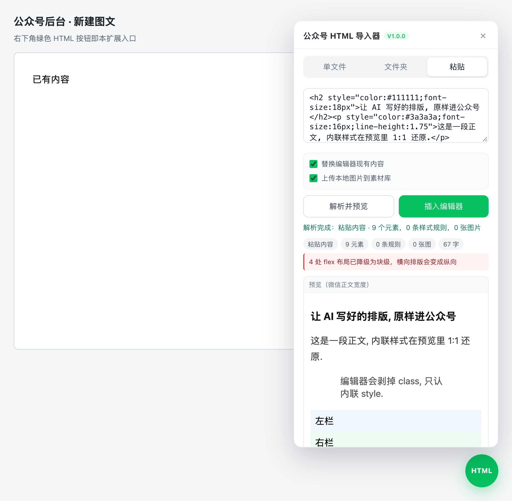

<div align="center">

# 公众号 HTML 导入器 · WeChat Article HTML Importer

**让 AI 写 HTML, 一键导入公众号编辑器, 排版不丢.**

**Turn AI-written HTML into a WeChat article in one click, layout intact.**

免注册 · 免付费 · 全程本地 · 只插入, 不保存, 不群发

No sign-up · No paywall · Runs 100% locally · Insert-only: never saves, never publishes

[](LICENSE)




</div>

> ⚠️ 非官方工具, 与微信 / 腾讯无关; 图片上传走公众号后台自己的接口. Unofficial tool, not affiliated with WeChat / Tencent. 详见 [免责声明 · Disclaimer](#disclaimer).

> 中文在前, 英文在后, 内容对应. Chinese first, English follows.

## 📑 目录 · Contents

- [为什么造它 · Why](#why)
- [特性 · Features](#features)
- [快速开始 · Quick Start](#quick-start)
- [让 AI 产出可导入的 HTML · Prompting your AI](#prompting)
- [什么能保留 · What survives](#support)
- [工作原理 · How it works](#how-it-works)
- [图片上传 · Images](#images)
- [隐私 · Privacy](#privacy)
- [开发与测试 · Development](#dev)
- [FAQ](#faq)
- [排障 · Troubleshooting](#troubleshooting)
- [Roadmap](#roadmap)
- [贡献 · Contributing](#contributing)
- [免责声明 · Disclaimer](#disclaimer)
- [License](#license)

<a id="why"></a>

## 💡 为什么造它 · Why

写过公众号的人都熟这套流程: 注册个编辑器, 登录, 挑模板, 一格一格拼. 模板库里没有的版式做不出来, 好用点的功能要开会员, 草稿还躺在别人的服务器上.

现在 AI 已经能把整篇文章连排版一起写成 HTML. 麻烦在于, 公众号编辑器**只认写在元素 `style` 里的内联样式**, `<style>`, class, id, 外链 CSS 一律剥掉, 直接粘贴必散架.

这个扩展做的就是中间的脏活, 全在你的浏览器里完成:

```
AI 生成带样式的完整 HTML
        |
        |  扩展本地处理 (不联网, 不上传)
        v
CSS 内联化 -> 微信白名单清洗 -> 本地图片上传素材库
        |
        v
一键插入公众号编辑器, 预览满意后你手动保存
```

版式能做到哪一步, 从此看你的 CSS, 模板库管不着.

If you write for a WeChat Official Account, you know the drill: sign up for some editor, log in, pick a template, assemble block by block. Layouts the template library doesn't ship are off-limits, the good stuff sits behind a membership, and your drafts live on someone else's server.

Meanwhile, any decent AI can write a whole article with its layout as HTML. The trouble: the WeChat editor **only accepts inline styles written on each element**; `<style>`, class, id and external CSS all get stripped, so a raw paste falls apart.

This extension does the dirty work in between, entirely in your browser -- see the pipeline above. How good your article looks now comes down to your CSS, and the template library no longer gets a vote.

| | 模板编辑器 · Template editors | 本工具 · This tool |
| --- | --- | --- |
| 账号 · Account | 注册 + 登录 · required | 不需要 · none |
| 费用 · Cost | 常见付费墙 · common paywall | 永久免费 · free, MIT |
| 版式上限 · Layout ceiling | 模板库 · template library | 你和 AI 写的 CSS · whatever CSS you write |
| 草稿去向 · Drafts | 存平台服务器 · vendor server | 留在本机 · stays local |
| 代码 · Code | 闭源 · closed | 5 个 JS 文件, 无构建 · 5 JS files, no build |

<a id="features"></a>

## ✨ 特性 · Features

- 🤖 排版交给 AI: 整篇文章让 AI 写成 HTML, 渐变, 卡片, 阴影, 圆角, 表格, 图文混排都能进正文. 模板库里没有的, 手写 CSS 补上.
  Let AI handle the layout: it returns HTML with gradients, cards, shadows, tables -- and whatever the template library lacks, your CSS covers.
- 💸 不注册, 不付费: 工具本身不要账号不要钱; 你的公众号后台能打开, 它就能用.
  No account, no fee: the tool asks for neither; if your MP backend opens, you are set.
- 🔒 全在本地跑: 内联和清洗都在浏览器里完成, 没有后台服务, 没有远程代码, 不收集数据.
  Everything runs locally: inlining and cleanup happen inside your browser -- no background service, no remote code, no data collection.
- 🖼️ 图片自动进素材库: 本地和 base64 图片串行传到你自己的账号下, 传不上去就变占位框, 原因写在旁边.
  Images upload themselves: local and base64 files go serially to your own material library; failures become placeholders with the reason attached.
- 🛡️ 插入后有校验: 编辑器把样式剥了就自动换一条路重试, 还不行就保住文字, 附一份诊断.
  Verified after insert: if the editor strips the styles, it retries another way; worst case the text survives, with a diagnosis attached.
- 🧩 不装扩展也能用: 浏览器打开 `extension/copy-page.html`, 解析, 预览, 复制, 自己去编辑器里粘贴.
  Zero-install option: open `extension/copy-page.html` in a browser, parse, preview, copy, and paste into the editor yourself.

<a id="quick-start"></a>

## 🚀 快速开始 · Quick Start

### 方式 A · 装扩展 (推荐) / Option A: install the extension

前置: Chrome / Edge / Brave 等 Chromium 浏览器 (Chrome 102+), 以及一个能登录的公众号账号.
Prerequisites: a Chromium browser (Chrome 102+, Edge, Brave) and your own WeChat MP account.

1. 下载或克隆本仓库 / Download or clone this repo
2. 打开 `chrome://extensions/` (Edge 为 `edge://extensions/`) / Open it
3. 打开右上角 "开发者模式" / Turn on **Developer mode**
4. 点 "加载已解压的扩展程序", 选择仓库里的 `extension/` 文件夹 / **Load unpacked**, pick the `extension/` folder
5. 打开 [公众号后台](https://mp.weixin.qq.com/) 新建图文, 右下角出现绿色 `HTML` 按钮: 选文件 -> "解析并预览" -> "插入编辑器"
   Open the [MP backend](https://mp.weixin.qq.com/), create a new article, and a green `HTML` button appears bottom-right: pick a file -> **parse & preview** -> **insert**.

装扩展不需要 Node 和 npm, 那是给跑测试的开发者用的.
Installing the extension needs no Node or npm -- those are for developers running the test suite.

### 方式 B · 零安装复制页 / Option B: zero-install copy page

不想装扩展? 用浏览器直接打开 `extension/copy-page.html`: 选文件或粘贴源码, 解析, 复制, 到编辑器里 `Cmd/Ctrl+V`. 限制: 复制页不能上传本地图片, 图片会替换为占位框.
No install at all? Open `extension/copy-page.html` in a browser: pick or paste HTML, parse, copy, then `Cmd/Ctrl+V` in the editor. Limitation: the copy page cannot upload local images; they become placeholders.

<a id="prompting"></a>

## 🤖 让 AI 产出可导入的 HTML · Prompting your AI

给 AI 的三条硬约束, 建议原样抄进提示词:
Three hard constraints worth copying verbatim into your prompt:

1. 整篇文章一个 HTML 文件, 样式集中在 `<style>` 里用 class 组织
2. 布局只用块级元素和 `table`; 不用 flex, grid, 定位, 动画, JS
3. 字号行高写 px, 颜色写完整 hex; 图片用 `` 加占位路径, 之后用 "文件夹模式" 配真实图片

1. One HTML file per article, styles in `<style>` organized by class.
2. Block elements and `table` for layout only; no flex, grid, positioning, animation, or JS.
3. Font sizes and line heights in px, colors in full hex; images as `` with placeholder paths, later paired with real files via folder mode.

"文件夹模式": 选包含 HTML 和图片子目录的文件夹, 扩展按相对路径自动匹配上传, 预览稿 (`*-preview.html` 或文件名含 "预览") 自动排在正文稿之后.
Folder mode: pick the folder holding the HTML plus image subfolders; the extension matches images by relative path, and preview files (`*-preview.html` or names containing "preview") sort after the main draft.

也可以把 [tests/fixtures/baseline.html](tests/fixtures/baseline.html) 直接喂给 AI 当范例.
You can also feed [tests/fixtures/baseline.html](tests/fixtures/baseline.html) to your AI as a reference example.

<details>
<summary>点开复制完整提示词 · Copy-paste prompt</summary>

中文版:

```text
你是微信公众号排版师. 请把下面的内容写成一篇完整的公众号文章, 输出单个 HTML 文件:
- 样式全部写在 <style> 里, 用 class 组织, 不写内联 style
- 布局只用块级元素 (section, p, h1-h6, blockquote) 和 table, 禁用 flex/grid/position/transform/animation/transition 和一切 JS
- 正文 15-16px, 行高 1.75, 段间距用 margin; 配色自定, 主色 #07c160
- 图片写成 , 我之后自己配图
- 输出前自检: 没有 flex/grid/position/animation, 没有 <script>
```

English:

```text
You are a WeChat Official Account layout designer. Turn the content below into one complete HTML file:
- All styles in a single <style> block, organized by class, no inline style attributes
- Layout with block elements (section, p, h1-h6, blockquote) and table only; no flex/grid/position/transform/animation/transition and no JS
- Body text 15-16px, line-height 1.75, spacing via margin; pick the palette, accent #07c160
- Images as ; I will supply real files later
- Self-check before output: no flex/grid/position/animation, no <script>
```

</details>

<a id="support"></a>

## 📊 什么能保留 · What survives

| 输入 · Input | 处理 · Treatment |
| --- | --- |
| `<style>` / class / id | 内联到元素 `style`, class 与 id 删除 · inlined into element `style`, then removed |
| div / article / figure 等语义标签 | 改名为 section 等微信安全标签 · renamed to WeChat-safe tags |
| 文字, 标题, 列表, 引用, 表格 | 接近 1:1 保留 · kept nearly 1:1 |
| flex / grid | 降级为块级, 报告提示 · degraded to block flow, reported |
| position / transform / animation / 伪元素 / @media | 移除, 报告提示 · removed, reported |
| CSS 背景图 | `url()` 移除, 纯色与渐变保留 · `url()` dropped, solids and gradients kept |
| 本地 / base64 图片 | 上传素材库, 失败变占位框 · uploaded to your library, placeholder on failure |
| 外链图片 | 保留原地址, 正文可能不显示 · kept as-is, may not render in articles |
| `<svg>` / `<video>` / `<iframe>` | 移除, 报告提示 · removed, reported |

文字和排版基本原样进去; 靠 flex, grid, 动画撑版式的图表和海报, 先转成图片再插.
Typography survives nearly 1:1. Charts and posters that lean on flex, grid or animation should become images first.

这条边界一半是微信划的 -- 正文里 JS 和 CSS 动画本来就进不去; 另一半是本工具的取舍 -- SVG 整体移除.
WeChat draws half of this line: JS and CSS animation never make it into articles. The tool draws the other half: SVG is dropped entirely.

<a id="how-it-works"></a>

## ⚙️ 工作原理 · How it works

1. **inliner.js** (纯函数, 不碰网络): 收集 `<style>` 规则, 按优先级内联到每个元素的 `style`; 解析 CSS 变量, rem 按 16px 折算; 只保留微信白名单内的标签和属性, 其余移除并逐项计数报告.
   **inliner.js** (pure functions, no network): collects `<style>` rules and inlines them onto elements by priority; resolves CSS variables, converts rem at 16px; keeps only WeChat-whitelisted tags and attributes and reports every removal with counts.
2. **core.js**: 编辑器定位 (同源 iframe 扫描), 注入级联, 图片上传, 文件排序.
   **core.js**: editor detection (same-origin iframe scan), the insertion cascade, image upload, file ordering.
3. **注入级联** (为什么不直接粘贴): 微信编辑器会对 `execCommand` 插入的内容剥内联样式, 所以扩展优先直写编辑器 body, 350ms 后校验样式计数, 不过关自动换 `execCommand` 重试, 全部失败则保留文字并给出诊断. 已知代价: 直写不走编辑器撤销栈, 本次插入 `Cmd+Z` 撤不掉, 需要撤销就重新导入一次.
   **The insertion cascade** (why not plain paste): the WeChat editor strips inline styles from `execCommand` inserts, so the extension writes the editor body directly first, verifies style counts after 350ms, falls back to `execCommand` if that fails, and keeps the text with a diagnosis if everything fails. Known cost: direct writes bypass the editor undo stack, so `Cmd+Z` will not undo this insert; re-import instead.

<a id="images"></a>

## 🖼️ 图片上传 · Images

上传走公众号后台编辑器自己的接口 (`/cgi-bin/filetransfer?action=upload_material`). 这是**未公开接口**, 微信改版可能失效; 失败时图片变为虚线占位框并显示原因, 此时在编辑器里手动上传就行. 只写入你自己的素材库, 串行限速, 10 张以上会先问你一句.
Uploads go through the MP backend editor's own endpoint (`/cgi-bin/filetransfer?action=upload_material`). It is **undocumented** and may break if WeChat changes it; failed images become dashed placeholders with the reason, and you can upload them manually in the editor. Uploads only write to your own material library, run serially with rate limiting, and batches of 10+ ask for confirmation.

<a id="privacy"></a>

## 🔒 隐私 · Privacy

- 只申请一个 host 权限: `https://mp.weixin.qq.com/*`
  A single host permission: `https://mp.weixin.qq.com/*`
- 无后台服务, 无遥测, 无远程代码, 不收集任何数据
  No background service, no telemetry, no remote code, no data collection
- 唯一网络请求: 向公众号后台上传图片 (同源, 带你的登录态)
  The only network request: image upload to the MP backend (same-origin, with your own session)
- 永不保存草稿, 永不群发, 永不调用发布接口
  Never saves drafts, never publishes, never calls any publishing API

<a id="dev"></a>

## 🧑‍💻 开发与测试 · Development

先说清楚: **扩展零依赖, 零构建**, npm 和 Node 只为跑下面的测试. 只想用扩展, 这一节整个跳过.
To be clear: **the extension has zero dependencies and no build step** -- npm and Node exist only to run the tests below. If you just want to use the extension, skip this section.

```bash
cd wechat-article-upload-extension
npm install
npm test
```

- `npm test` 用本机 Chrome 跑 14 项检查 (可用 `CHROME_PATH` 指定路径), fixtures 自包含; 其中 "敌对编辑器" 用例模拟微信剥样式的 `execCommand`, 验证注入级联能自动换路
  `npm test` runs 14 checks in your local Chrome (override with `CHROME_PATH`), with self-contained fixtures; the "hostile editor" case simulates WeChat's style-stripping `execCommand` and verifies the cascade falls back correctly
- 换用自己的样例: `WXH_BASELINE` / `WXH_STRESS` 环境变量
  Use your own samples via the `WXH_BASELINE` / `WXH_STRESS` environment variables

<a id="faq"></a>

## ❓ FAQ

**"免注册免登录" 是什么口径?** 这个工具本身不注册, 不登录, 不付费. 你只需要像平常一样登录自己的公众号后台 -- 它操作的就是你正在用的那个页面.
**What does "no sign-up" cover?** The tool itself needs no account and no payment. You just log into your own WeChat MP backend as usual; the extension works on the page you already use.

**为什么不用官方 API?** 草稿箱接口需要认证公众号加 AppID / Secret 加 IP 白名单; 本工具零配置, 任何能登录后台的账号都能用.
**Why not the official API?** The draft API requires a verified account, AppID/Secret and an IP whitelist; this tool is zero-config for any account that can open the backend.

**支持 Edge / Firefox 吗?** Chromium 系 (Edge, Brave 等) 可直接加载未打包扩展; Firefox 未适配 MV3 清单.
**Edge / Firefox?** Chromium browsers (Edge, Brave) load the unpacked extension as-is; Firefox is not adapted to the MV3 manifest yet.

**会自动发布文章吗?** 永不. 插入之后, 预览, 保存, 群发全部由你手动完成.
**Does it publish for me?** Never. Preview, save and publish stay entirely manual.

**插入后格式还是丢了?** 看状态栏: 显示 "插入未通过校验" 就点面板底部 "复制诊断", 提交 Issue 并附上诊断内容.
**Styles still lost after inserting?** Check the status bar; if it says verification failed, click "copy diagnostics" at the panel bottom and attach it to an issue.

<a id="troubleshooting"></a>

## 🩹 排障 · Troubleshooting

| 现象 · Symptom | 处理 · Fix |
| --- | --- |
| 右下角没有按钮 · no button | 确认在图文编辑页 (不是列表页); 刷新页面; 点 "检测编辑器" 看候选 · make sure you are on the article editor page, refresh, or click "detect editor" |
| 版式不对 · layout off | 先看报告降级项 (flex / grid 一定会变); 图表类先转图片 · check the degradation report first (flex/grid always change); rasterize charts |
| 图片全是占位框 · all placeholders | 看上传失败原因; 确认文件夹选对; 微信接口改版时手动上传 · read the failure reason, check the folder, or upload manually if WeChat changed the API |
| 控制台出现 "Blocked script execution in 'about:blank'" | 微信页面自带沙箱组件的噪音, 不影响功能, 通常自行消失 · noise from WeChat's own sandboxed components; harmless and usually self-clears |

<a id="roadmap"></a>

## 🗺 Roadmap

- [ ] Firefox MV3 适配 · Firefox MV3 support
- [ ] 面板界面 i18n (当前为中文) · panel UI i18n (currently Chinese-only)
- [ ] SVG / 图表自动转图片 · auto-rasterize SVG charts to images

<a id="contributing"></a>

## 🤝 贡献 · Contributing

提 Issue / PR 前请先跑通 `npm test`; 涉及注入逻辑的改动请附 "敌对编辑器" 用例的验证结果.
Please run `npm test` before opening an issue or PR; for changes to the insertion logic, attach the "hostile editor" case result.

<a id="disclaimer"></a>

## ⚠️ 免责声明 · Disclaimer

- 本项目为个人开源工具, 非官方, 与微信 / 腾讯无关; 相关名称与商标归其所有者
  A personal open-source tool, unofficial and not affiliated with WeChat / Tencent; all names and trademarks belong to their owners
- 图片上传依赖公众号后台未公开接口, 随时可能失效, 不做可用性承诺
  Image upload relies on an undocumented backend endpoint that may break at any time; no availability promise
- 请勿用于绕过平台审核, 批量群发, 爬取他人内容等场景; 使用后果由使用者自行承担
  Do not use it to evade platform review, mass-send, or scrape others' content; you bear the consequences of use
- MIT 协议只覆盖本仓库代码, 不覆盖任何第三方数据, 商标或服务
  The MIT license covers this repository's code only, not any third-party data, trademarks or services

<a id="license"></a>

## 📄 License

[MIT](LICENSE) (c) 2026 lanceagi
